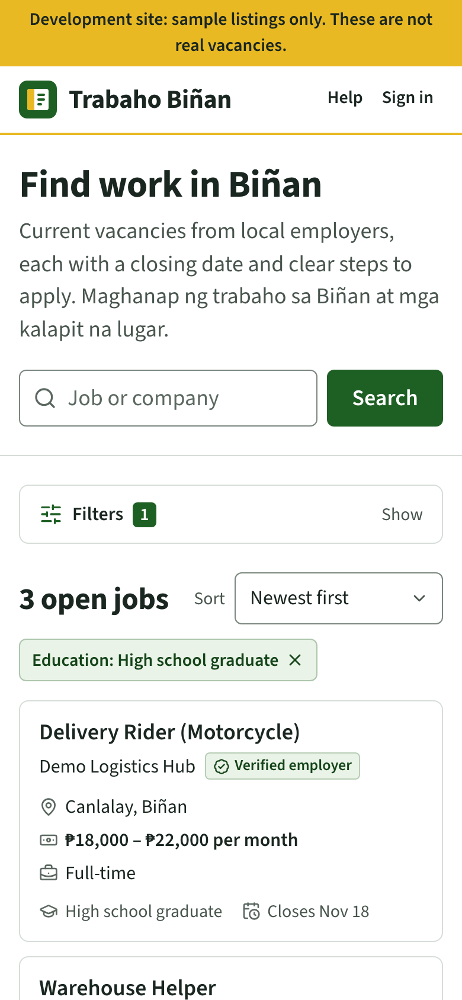
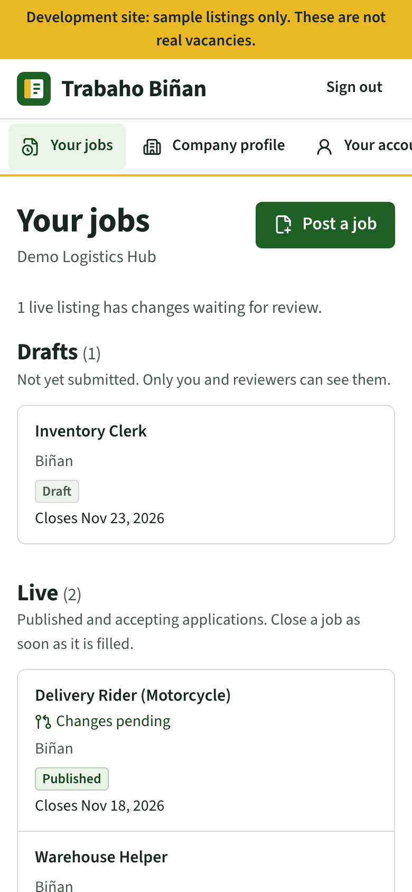
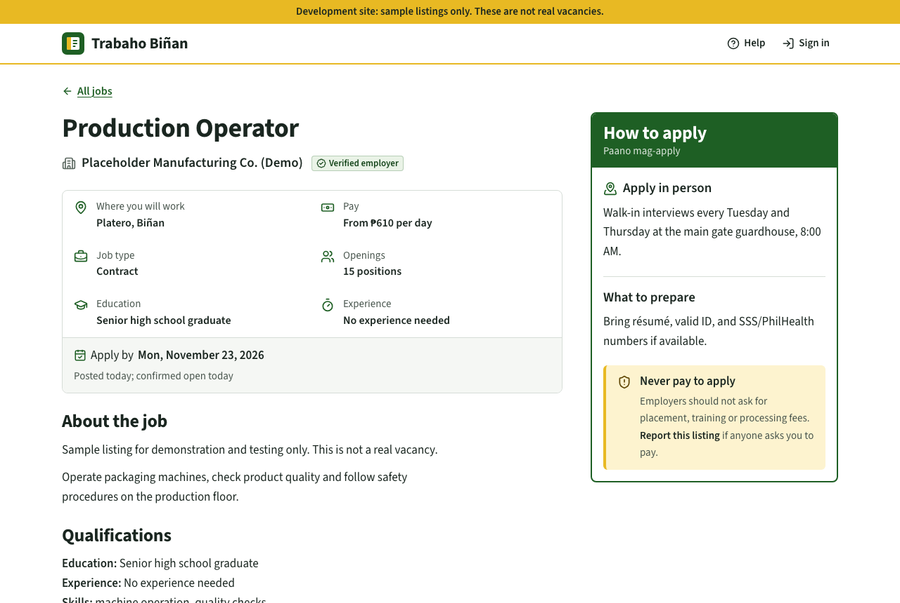
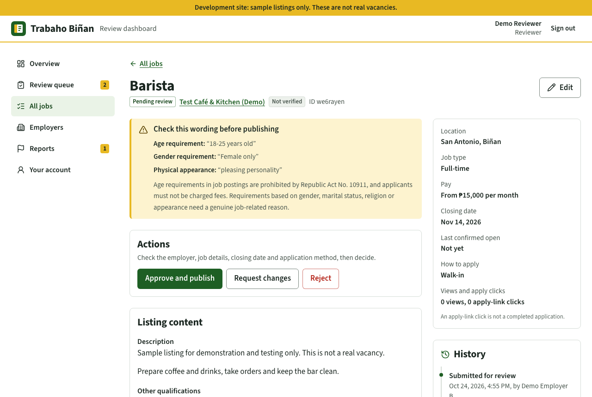
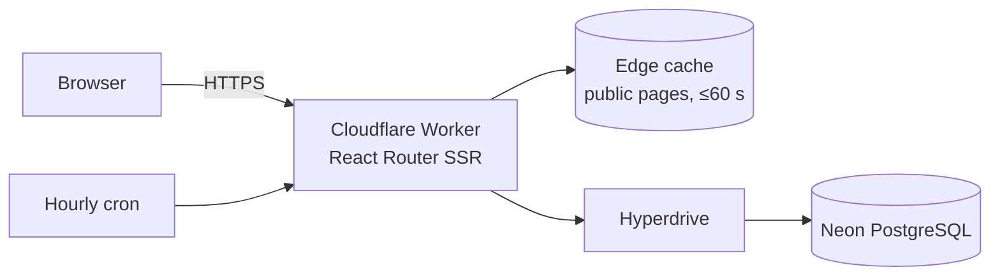

# Trabaho Biñan — Local Job Portal

The job portal of the Public Employment Service Office (PESO) of the City
Government of Biñan, Laguna. Residents can find current local vacancies and see
exactly how to apply. PESO reviewers and invited employers keep the listings
accurate. The software is built and maintained pro bono.

The PESO Biñan logo and the City of Biñan seal are used with permission. They
belong to their owners and are **not** covered by the MIT licence; see
[app/assets/logos/README.md](app/assets/logos/README.md).

**Status:** first release (public directory, review dashboard and employer
pilot), deployed for pilot use at
[trabaho.bantaybinan.com](https://trabaho.bantaybinan.com). Direct
applications and résumé uploads are planned for a later phase. See
[docs/progress.md](docs/progress.md) for the current state and
[docs/project-plan.md](docs/project-plan.md) for the full plan.

<p>
  
  
</p>





_Screenshots use synthetic demo data (marked by the yellow banner)._

## What it does

**For jobseekers (no account needed)**

- Search by job title, company or skill. Filter by location, job type,
  education and experience ("jobs open to my level"), employer or agency, and
  work setup.
- Every listing shows where the work is, the pay (or _Not disclosed_), the
  closing date, and clear instructions to apply online, by email or in person.
- Closed and expired listings keep their page with a notice, but cannot be
  applied to. Anyone can report a listing.

**For reviewers (PESO staff or other authorised moderators)**

- A review queue that flags wording needing a policy check (age limits, fees,
  gender and similar).
- Approve, request changes, reject, pause, close, renew and reopen listings,
  and review employers' proposed changes field by field.
- Verify or suspend employers, invite employer staff, handle reports, see
  listings that are closing soon or need reconfirmation, and export CSV.

**For invited employers**

- Draft and submit vacancies, read review feedback, close a filled job
  immediately, and request changes or extensions. The approved version stays
  live until a reviewer approves the change.
- Employers only ever see their own organization's records.

**For administrators**

- Invite staff, change roles, suspend accounts (effective immediately), issue
  password-reset links, view the audit history and edit site settings.

Out of scope for this release: jobseeker accounts, applications and résumés,
AI matching, chat, SMS and automatic Facebook posting.

## Technology

| Layer       | Choice                                                                  |
| ----------- | ----------------------------------------------------------------------- |
| App         | TypeScript, React Router 8 (framework mode), React 19                   |
| UI          | Tailwind CSS 4, shadcn/ui primitives, Lucide icons                      |
| Hosting     | Cloudflare Workers (Free), Cron Triggers, Workers Rate Limiting         |
| Database    | Neon PostgreSQL (Free, AWS Singapore) via Cloudflare Hyperdrive         |
| Data access | Drizzle ORM and versioned SQL migrations                                |
| Auth        | Better Auth (server-side only), bcrypt in PostgreSQL                    |
| Tests       | Vitest (unit and integration), Playwright with axe accessibility checks |

The architecture, security model and design decisions are explained in
[docs/architecture.md](docs/architecture.md).



## Local development

Requirements: Node.js 22.18 or newer (24 recommended), and PostgreSQL 16 or
newer with `pgcrypto` (included in standard PostgreSQL packages).

```sh
git clone https://github.com/TonyTech404/trabaho-binan.git
cd trabaho-binan
npm ci

cp .env.example .env              # set your local connection strings
cp .dev.vars.example .dev.vars    # set BETTER_AUTH_SECRET (openssl rand -base64 48)

createdb trabaho_dev
npm run db:migrate
SEED_PASSWORD='choose-a-local-password' npm run db:seed
npm run dev
```

Open http://localhost:5173. The seed creates synthetic accounts
(`admin@example.test`, `reviewer@example.test`, `employer.a@example.test`,
`employer.b@example.test`) using your `SEED_PASSWORD`, plus fictional
employers marked "(Demo)". A yellow banner marks every non-production site.

## Testing

```sh
createdb trabaho_test && createdb trabaho_e2e

npm test            # unit + integration tests (rebuilds TEST_DATABASE_URL)
npm run test:e2e    # Playwright against the production build (rebuilds E2E_DATABASE_URL)
npm run lint && npm run format:check && npm run typecheck && npm run build
```

The integration tests cover the security-critical rules: organization
boundaries, review and publication, revisions, expiry and closure, suspension,
invitations and password resets. The end-to-end tests drive the real pages on
desktop and mobile viewports, check keyboard use, and run axe accessibility
scans. GitHub Actions runs everything on every pull request.

## Deployment and operations

Production runs on Cloudflare Workers with a Neon database. Staging uses
synthetic data on workers.dev.

```sh
CLOUDFLARE_ENV=staging    npm run build && npx wrangler deploy
CLOUDFLARE_ENV=production npm run build && npx wrangler deploy
```

[docs/operations.md](docs/operations.md) covers environments, free-tier
quotas, migrations, deployment checks, administrator setup, encrypted backups
and restoration, maintenance and incident response.

## Project structure

| Path              | Contents                                                       |
| ----------------- | -------------------------------------------------------------- |
| `app/routes/`     | Public pages, `/manage` (reviewers and admins), `/employer`    |
| `app/components/` | Shared interface components (`ui/` holds shadcn/ui primitives) |
| `app/services/`   | Business rules and permission checks (`*.server.ts`)           |
| `app/db/`         | Drizzle schema and the per-request database client             |
| `app/lib/`        | Auth, validation, security headers, caching, time and labels   |
| `workers/`        | Worker entry: fetch handler and scheduled expiry               |
| `drizzle/`        | Versioned SQL migrations                                       |
| `scripts/`        | Seed, administrator invitation, backup and restore, SQL grants |
| `tests/`          | Vitest unit and integration tests; Playwright end-to-end tests |
| `docs/`           | Plan, architecture, operations, design system, progress log    |

## Contributing and security

See [CONTRIBUTING.md](CONTRIBUTING.md). Please report vulnerabilities privately
as described in [SECURITY.md](SECURITY.md).

## License

[MIT](LICENSE)
