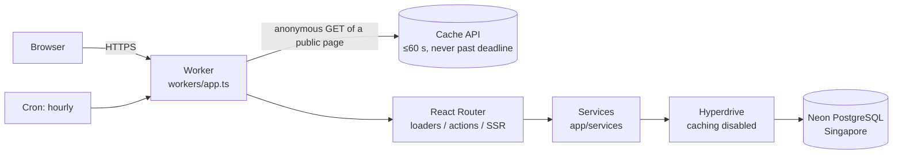
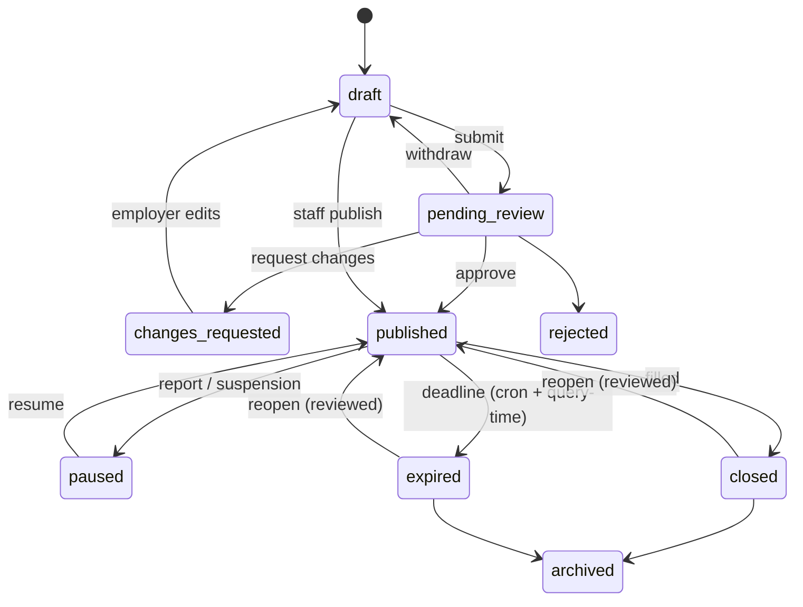

# Architecture

One full-stack TypeScript application on Cloudflare Workers, backed by Neon
PostgreSQL. This page explains how a request flows, where rules are enforced,
and the decisions behind the less obvious choices. The product scope is in
[project-plan.md](project-plan.md).

## Request flow

1. `workers/app.ts` rejects cross-site form posts, then serves anonymous
   public pages from a short-lived edge cache when possible.
2. React Router runs route middleware, loaders and actions, and renders HTML.
3. Loaders and actions call **services** (`app/services/*.server.ts`). Every
   service takes the signed-in actor and enforces permissions itself.
4. Services use Drizzle ORM over one PostgreSQL connection per request
   (`pg.Client` through Hyperdrive). The connection opens lazily.
5. The Worker adds security headers (nonce-based CSP, HSTS, frame denial) to
   every response and marks signed-in responses `private, no-store`.

The Worker runs with targeted placement in `aws:ap-southeast-1`, next to the
database, because most pages make several queries.

## Where rules are enforced

| Layer                                     | Responsibility                                                                  |
| ----------------------------------------- | ------------------------------------------------------------------------------- |
| Route middleware (`/manage`, `/employer`) | Signed in, correct role, account active                                         |
| Every loader and action                   | Calls `requireViewer`/`requireStaffViewer`/… again                              |
| Services                                  | Permission checks, organization scoping, valid state transitions, audit records |
| Database                                  | Restricted runtime role: row access only, no DDL, history tables append-only    |

Employer access is scoped by the organization stored on the session, never by
form input. A job belonging to another organization is reported as _not found_,
so its existence is not revealed.

## Authentication

- **Better Auth** handles credentials and sessions, but only as a server-side
  library: its HTTP handler is not mounted. Sign-in, sign-out and password
  changes are this app's own actions calling `auth.api.*`.
- **No public sign-up.** Accounts are created only by accepting a single-use
  invitation (SHA-256 hash stored, 7-day expiry).
- **Passwords are hashed in PostgreSQL** with pgcrypto bcrypt (cost 10).
  Workers Free allows 10 ms of CPU per request and Better Auth's default scrypt
  has exceeded it on Workers. The password reaches the database as a bound
  parameter over TLS.
- **Sessions are read fresh** on every request (no cookie cache), so
  suspension, role changes and password resets apply immediately. Suspending
  an account also deletes its sessions.
- **No email provider** in the $0 pilot. Invitations and password resets are
  links shown once to the staff member who creates them.

## Vacancy lifecycle

Changes an employer makes to a live listing become a **revision**
(`job_revisions`, at most one open per job). The approved version stays live
until a reviewer approves the revision. Renewals and reopen requests use the
same flow. Staff, who approve listings, can correct a live listing directly;
the change is recorded.

## Data model

| Table                                            | Purpose                                                                        |
| ------------------------------------------------ | ------------------------------------------------------------------------------ |
| `users`, `sessions`, `accounts`, `verifications` | Better Auth tables, plus `role` and `status` on users                          |
| `organizations`, `organization_members`          | Employers and agencies; one organization per employer account                  |
| `jobs`                                           | Current content and lifecycle of each vacancy; generated `tsvector` for search |
| `job_revisions`                                  | Proposed changes to published jobs and their review decision                   |
| `job_events`                                     | Employer-visible timeline of review and lifecycle events                       |
| `listing_reports`                                | Public reports and their resolution                                            |
| `job_metrics_daily`                              | Daily totals of views and apply-link clicks (no visitor data)                  |
| `audit_events`                                   | Who changed what and when (append-only for the app)                            |
| `account_links`                                  | Hashed single-use invitation and reset tokens                                  |
| `settings`                                       | Site settings and the environment marker                                       |

## Freshness and caching

- Public queries always require `status = 'published'` and a deadline in the
  future, so an expired job never appears as open even if the cron is late.
- The hourly cron marks past-deadline jobs `expired` and purges their pages.
- Anonymous public pages are cached for up to 60 seconds and never past the
  vacancy deadline. Lifecycle changes purge the job page.
- `/apply/:id` is never cached and re-checks the job before redirecting. A
  stale cached page therefore cannot send anyone to a closed vacancy.
- Hyperdrive query caching is disabled so permissions, sessions and closures
  are always read fresh.

## Decisions log

| Decision                                        | Reason                                                                                  |
| ----------------------------------------------- | --------------------------------------------------------------------------------------- |
| Neon PostgreSQL rather than D1                  | Avoids a later SQLite-to-PostgreSQL migration (plan §10)                                |
| bcrypt in PostgreSQL                            | Keeps CPU-heavy hashing off the Workers Free 10 ms budget                               |
| Better Auth without its HTTP routes             | Smallest public endpoint surface; invite-only accounts                                  |
| Manual invitation/reset links                   | Cloudflare Email Sending to arbitrary recipients needs Workers Paid                     |
| One cron, production only                       | The account allows five Cron Triggers in total                                          |
| All employer edits to live listings reviewed    | Simpler and safer than classifying "material" fields                                    |
| Administrators include reviewer permissions     | Practical for the pilot; future applicant-document access will be a separate permission |
| Public UI makes no PESO/City affiliation claims | No official partnership confirmed; operator name is configurable                        |
