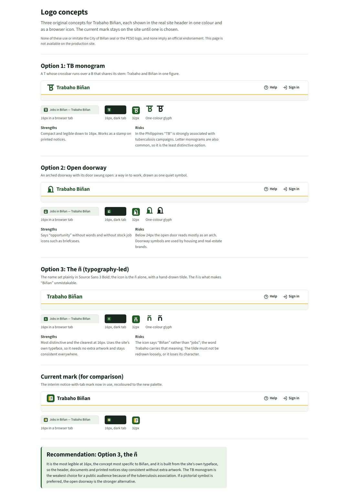

# Logo concepts

**Status:** awaiting the owner's choice. The interim mark (a notice with a gold tab) stays on
the site until then.

Three original, single-colour concepts for Trabaho Biñan's own identity. None of them use,
trace or imitate the City of Biñan seal or the PESO logo, and none should be presented as an
official city or PESO mark.

To compare them in the browser, run `npm run dev` and open
[`/brand-preview`](http://localhost:5173/brand-preview). The page also works on staging and
returns 404 in production.

| Option                    | Header lockup                        | Icon                                 | Source files                                   |
| ------------------------- | ------------------------------------ | ------------------------------------ | ---------------------------------------------- |
| 1. TB monogram            | glyph + name                         | T crossbar over a B sharing its stem | `app/assets/brand/monogram-{mark,favicon}.svg` |
| 2. Open doorway           | glyph + name                         | Arched doorway, door swung open      | `app/assets/brand/doorway-{mark,favicon}.svg`  |
| 3. The ñ (typography-led) | name only, set in Source Sans 3 Bold | ñ with a hand-drawn tilde            | `app/assets/brand/enye-{mark,favicon}.svg`     |

`*-mark.svg` files draw in `currentColor` (one colour, any background).
`*-favicon.svg` files are the 32×32 tile: the glyph knocked out of a `pine` square.

## Assessment

**1. TB monogram.** Compact and legible at 16px. However, "TB" is strongly associated with
tuberculosis in Philippine public-health messaging, and letter monograms are common. This is
the weakest option for a public audience.

**2. Open doorway.** Suggests opportunity without stock job imagery such as briefcases or
handshakes. Below about 24px the open door reads mostly as an arch, and doorway symbols are
common in housing and real-estate branding.

**3. The ñ.** The ñ is what makes "Biñan" unmistakable, and it is the clearest of the three
at 16px. The wordmark is plain Source Sans 3 Bold, so the header, documents and printed notices
stay consistent with the interface without extra artwork. The icon says "Biñan" rather than
"jobs"; the word _Trabaho_ carries that meaning.

## Recommendation

**Option 3, the ñ.** It is the most distinctive, the most legible at small sizes and the
cheapest to apply consistently. If a pictorial symbol is preferred, choose option 2.

## After a choice is made

1. Replace `LogoMark` in `app/components/wordmark.tsx` with the chosen glyph (or, for option 3,
   remove the mark and set the name at about 24px bold).
2. Replace `public/favicon.svg` with the chosen `*-favicon.svg`.
3. Before print or signage use, convert any live text in the wordmark to outlines and check
   the tilde at the final size.
4. Remove `/brand-preview`, `app/components/brand/` and the unused concept files.
5. Update the "Logo" section of [`../design-system.md`](../design-system.md).
